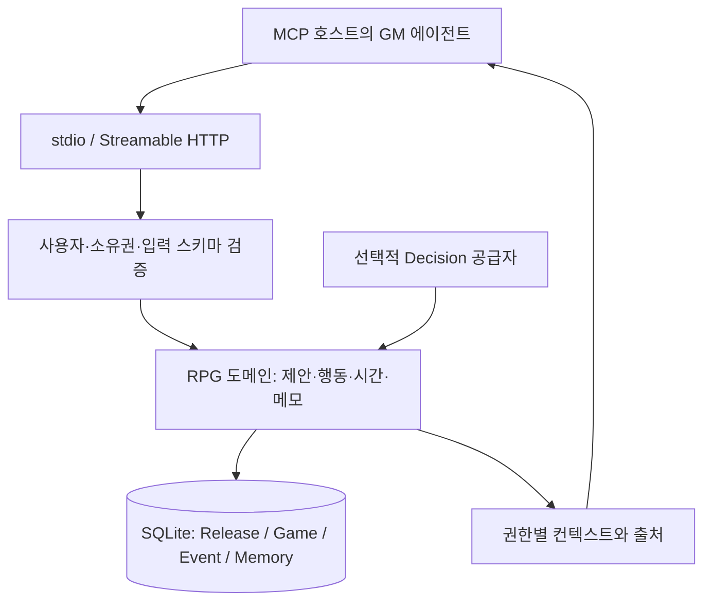

# 구조와 상태 경계

문서 상태: 구현 구조 안내 / 제품 0.4.0 / 2026-10-27. 세부 계약은 src/rpg의 MCP 스키마와 tests를 기준으로 확인합니다.

`src/`의 기반 메모리 계층은 검색·그래프·저장 기능을 제공합니다. `src/rpg/`는 게임 규칙, 확장 계약, 권한, 상태 재생과 MCP 전송을 담당합니다. `scripts/`는 서버 실행·샘플·평가를 조합하며, SQL 변경은 `migrations/`에 둡니다.

세계 초안은 검증 후 불변 Release가 됩니다. Game은 Release를 고정하고 추가 설정을 overlay로 확정합니다. 에이전트의 자유 서술만으로 세계 사실을 덮어쓰지 않습니다. 행동 결과는 사건·기억·출처·스냅샷과 함께 저장하며 트랜잭션·revision·멱등성 검사를 적용합니다.

GM 메모와 숨겨진 마감 결과는 플레이어 관측과 다릅니다. 메모 revision과 추천 예산도 게임 행동 시간과 분리합니다. `turn_seq`, 논리 `world_tick`, 세계의 경과 초는 서로 대신 사용할 수 없습니다. 시간은 선택적으로 활성화하며 현재는 첫 행동 전에 설정해야 합니다.

서버는 외부 GM 모델을 자동 호출하지 않습니다. 선택적 Decision 공급자는 GM 서술 생성기와 역할이 다릅니다. 원격 HTTP의 인증에는 외부 IdP가 필요합니다.

저장 무결성이 세계 설정의 의미 정합성까지 검증하지는 않습니다. 잠금과 이동의 관계, 과거 사실의 종료, NPC 실제 이동 등은 [알려진 한계](known-issues.md)를 확인하세요.
